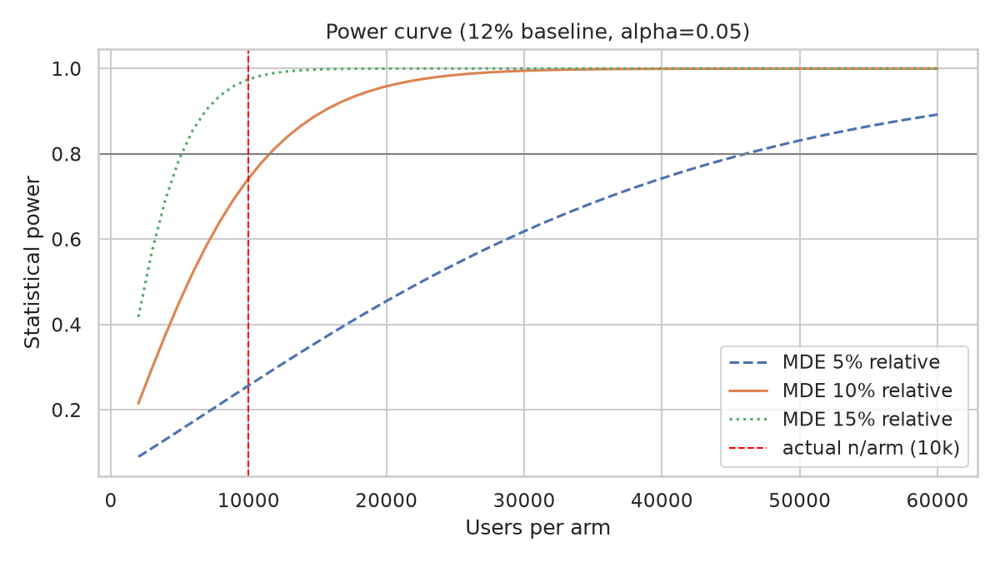
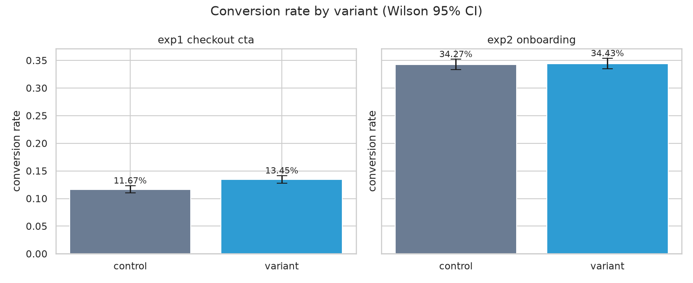
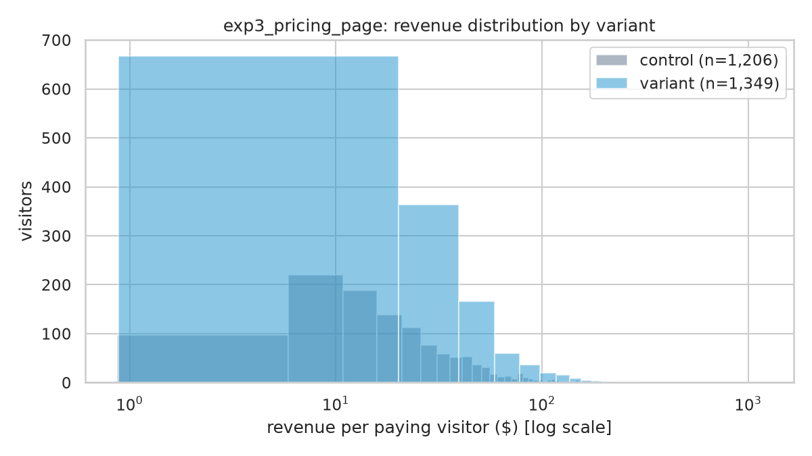
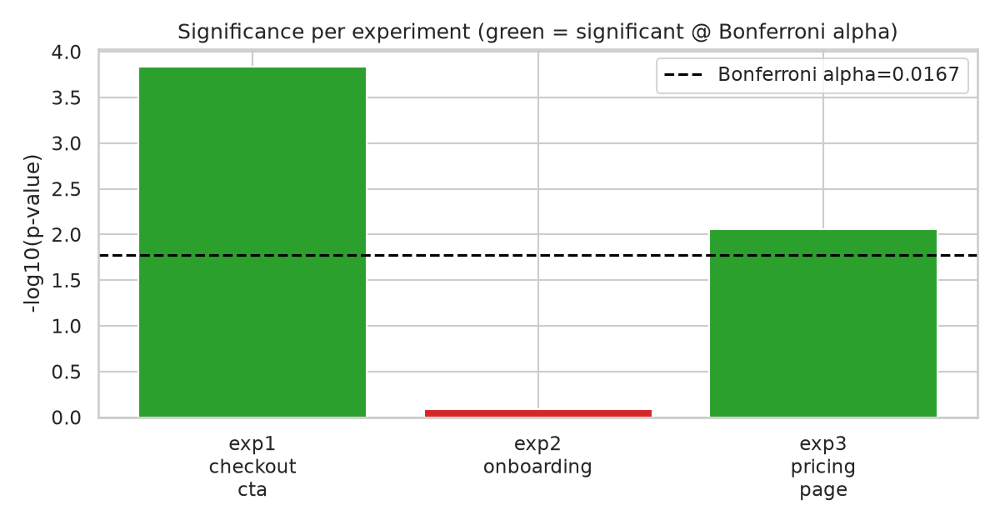
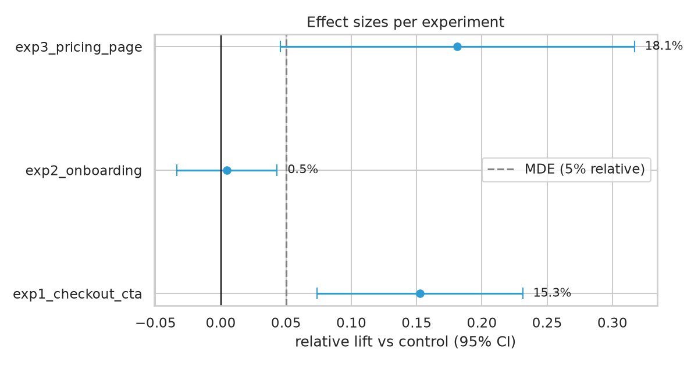

# A/B Testing & Experimentation Analysis

Design and analyze A/B experiments the way a product analyst would — from power analysis and sample-ratio checks to a ship/no-ship recommendation. Built on **fully synthetic data** (no real users, no real company).

## Business Problem

Product teams constantly ask *"did the change work?"* — and the honest answer requires more than comparing two averages. This project walks through three realistic experiments end to end:

| Experiment | Metric | Story |
|---|---|---|
| `exp1_checkout_cta` | Conversion rate (binary) | Clear winner — ship it |
| `exp2_onboarding` | Activation rate (binary) | **Null result** — reported honestly, not forced into significance |
| `exp3_pricing_page` | Revenue per visitor (continuous) | Looks like a win, but the **SRM check flags a broken randomization** |

The point: a good analyst ships winners, kills losers, and — most importantly — refuses to ship on untrustworthy data.

## Dataset

Synthetic experiment log generated by `src/generate_data.py` (seeded, `random_state=42`, reproducible):

- **60,000 rows** — ~20,000 users per experiment, assigned over 14 days (2026-10-01 → 2026-10-14)
- Columns: `experiment_id`, `user_id`, `variant` (control/variant), `converted` (0/1), `revenue` (0 for non-buyers), `assignment_date`
- `exp3_pricing_page` deliberately contains a slight sample-ratio mismatch (10,150 vs 9,850) to demonstrate the SRM check
- Total size ~3 MB (CSV)

> ⚠️ **All data is synthetic.** There are no real users, no real experiments, and no real company behind these numbers.

## Objectives

1. Size each experiment with power analysis (80% power, 5% relative MDE)
2. Validate data quality and check the sample ratio (SRM) before trusting results
3. Run the right test per metric: two-proportion z-test (binary), Welch's t-test (revenue)
4. Correct for multiple testing (Bonferroni across 3 experiments)
5. Report the null result honestly and issue a ship / no-ship / investigate recommendation per experiment

## Data Cleaning

`src/data_cleaning.py` validates the raw log:
- 60,000 rows in → 60,000 rows out (0 missing values, 0 duplicates — verified, not assumed)
- Variant labels standardized; unexpected labels would be flagged
- Assertions: known experiment IDs only, `converted` ∈ {0,1}, `revenue` ≥ 0, and `converted == (revenue > 0)` consistency for the revenue experiment

## SQL Analysis

`sql/analysis_queries.sql` (SQLite-compatible) covers the analyst's first-pass queries:
- Users and conversions by variant per experiment
- Daily conversion trend by variant (guards against day-of-week or ramp-up effects)
- SRM check: observed vs expected 50/50 split per experiment
- Revenue per visitor by variant

## EDA

- Variant splits verified (SRM p = 1.0 for exp1/exp2 → clean; p = 0.034 for exp3 → **flagged**)
- Baseline conversion rates: 11.7% (checkout), 34.3% (onboarding) — healthy, realistic ranges
- Revenue per visitor is zero-inflated (most visitors spend $0); buyers follow a right-skewed distribution — hence Welch's t-test, not Student's

## Key Insights

1. **The checkout CTA is a real win**: +15.3% relative conversion lift, p = 0.0001 — significant even after Bonferroni correction. Ship it.
2. **The onboarding flow did nothing**: +0.5% lift, p = 0.81. With 10k users per arm this isn't "underpowered for a big effect" — there's simply no effect to find. Kill it and revisit the hypothesis.
3. **The pricing page result can't be trusted yet**: +18.1% revenue lift looks great (p = 0.0088), but the SRM check caught a 10,150/9,850 split (p = 0.034). A broken randomization invalidates everything downstream — audit the assignment logging before any ship decision.
4. **Power analysis lesson**: detecting a 5% relative lift on a 12% baseline at 80% power needs ~46k users/arm; this design (10k/arm) reliably detects lifts ≥ ~11% — the observed wins cleared that bar.

## Statistical Methodology

| Choice | Detail |
|---|---|
| Tests | Two-proportion z-test (binary metrics), Welch's t-test (revenue — unequal variances, zero-inflated) |
| Alpha | 0.05 two-sided, **Bonferroni-adjusted to 0.0167** across the 3 experiments |
| Power / MDE | 80% power; 5% relative minimum detectable effect for sizing |
| Intervals | Wilson score intervals for conversion rates; normal-approx CIs for lift |
| Guardrails | Chi-square SRM check per experiment; decision rule blocks shipping on SRM failure |
| Multiple testing | Bonferroni noted; experiment 1 & 3 remain significant after correction |

## Dashboard







## Results & Metrics

| Experiment | Metric | Control | Variant | Rel. lift | p-value | SRM p | Recommendation |
|---|---|---|---|---|---|---|---|
| exp1_checkout_cta | Conversion | 11.67% | 13.45% | **+15.3%** | 0.0001 ✅ | 1.0000 | **SHIP** |
| exp2_onboarding | Activation | 34.27% | 34.43% | +0.5% | 0.8117 ❌ | 1.0000 | **NO SHIP** |
| exp3_pricing_page | Revenue/visitor | $3.57 | $4.22 | +18.1% | 0.0088 ✅ | 0.0339 ⚠️ | **DO NOT SHIP — investigate SRM** |

✅ = significant at Bonferroni alpha 0.0167 · ❌ = not significant · ⚠️ = SRM check failed

## Technologies Used

Python, pandas, NumPy, SciPy, statsmodels, matplotlib, seaborn, Jupyter, SQLite-style SQL

## How to Run

```bash
python -m venv .venv && source .venv/bin/activate
pip install -r requirements.txt

# 1. generate the synthetic data
python src/generate_data.py
# 2. run the full analysis (prints the results table + recommendations)
PYTHONPATH=src python src/experiment.py
# 3. explore the narrative notebook
jupyter notebook notebooks/analysis.ipynb
```

SQL queries in `sql/analysis_queries.sql` run against `data/experiments.csv` loaded into any SQLite database (e.g. `sqlite3 exp.db < sql/analysis_queries.sql` after `.import`).

## Resume-Ready Description

Built an end-to-end A/B testing analysis on synthetic experiment data: power analysis and MDE sizing, two-proportion z-tests and Welch's t-tests with Bonferroni correction, sample-ratio-mismatch (SRM) checks, and ship/no-ship recommendations across 3 experiments — including an honestly reported null result.
